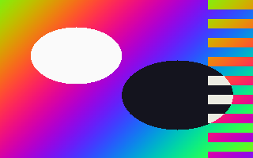
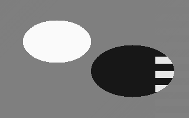
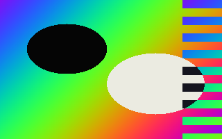
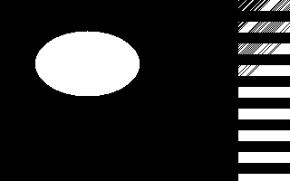
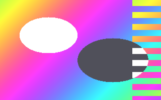
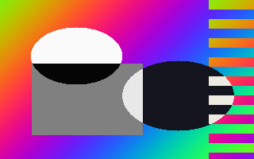
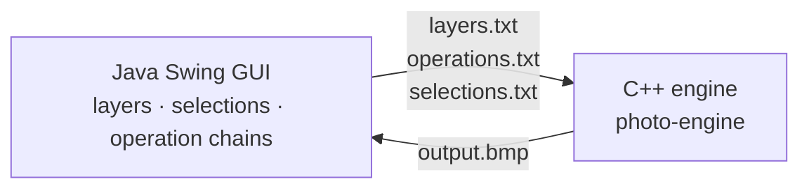

# Photo editor

[](https://github.com/FansteLK/Photo-editor/actions/workflows/ci.yml)

A layered image editor with a **Java Swing GUI** and an image-processing engine written in **C++**. You stack images as layers with opacity, draw rectangular selections, and build chains of pixel operations. The GUI hands the job to the engine, which composites the layers, applies the operations inside the selection, and writes the result.

It was built for the *Practicum in Object-Oriented Programming* course at the School of Electrical Engineering, University of Belgrade.

| Original | Greyscale | Invert |
| --- | --- | --- |
|  |  |  |
| **Black & white** | **Brighten (+60)** | **Greyscale + invert, inside a selection** |
|  |  |  |

## Architecture



The C++ engine is object-oriented throughout:

- **`Image`** is a singleton holding a stack of **`Layer`**s, each a matrix of **`Pixel`**s with an alpha channel. Layers of different sizes are padded to a common canvas and blended by opacity.
- **`Selection`** is a set of **`Rectangle`**s. Operations are applied through a visitor (`Image::Visit`) that only touches selected pixels when a selection exists.
- **`BasicOperation` / `Operations`** are per-pixel operations: add, subtract, inverse subtract, multiply, divide, inverse divide, power, log, min, max, abs, invert, greyscale, black & white. There's also `medijana`, a 3×3 smoothing filter. Despite its name it averages the 8 neighbours (a box blur) rather than taking their median.
- **`CompositeOperation`** parses a text file of `name;constant;` lines into a chain of operations, so users can save and reuse custom filters.
- **`Formatter`** reads and writes 32-bit BMP and PAM (Netpbm) images.

## Building and running

Requirements: a C++17 compiler, JDK 8+, and `make`.

```bash
make            # builds build/photo-engine and build/photo-editor.jar
make run        # starts the GUI
make demo       # runs every operation on a generated sample image → build/demo/
```

The engine also works on its own from the command line:

```bash
echo "photo.bmp 100"        > layers.txt       # <image> <opacity>, one layer per line
printf 'greyscale;0;\nsabiranje;40;\n' > ops.txt  # <operation>;<constant>;
echo "10 10 200 120"        > selection.txt    # <x> <y> <width> <height> (empty file = whole image)
build/photo-engine layers.txt ops.txt selection.txt result   # writes result.bmp
```

Operation names are in Serbian, as in the original assignment: `sabiranje` (add), `oduzimanje` (subtract), `mnozenje` (multiply), `deljenje` (divide), `stepenovanje` (power), `logaritam`, `min`, `max`, `abs`, `inverzija` (invert), `greyscale`, `black&white`, `medijana` (3×3 smoothing).

Input images must be 32-bit BMPs. Selection coordinates start at the bottom-left, as BMP rows are stored bottom-up.

## Changes since the course submission

- **Portability:**
  - Removed hard-coded `C:\Users\…` paths for the engine and output files.
  - The GUI locates the engine with `-Dphotoeditor.engine` and writes to the system temp directory.
  - The engine takes the output path as an argument.
- **Correctness:**
  - Channel values are clamped to 0–255. Before, they wrapped around, so brightening turned bright pixels dark.
  - The engine reports unsupported, non-32-bit BMPs instead of producing garbage.
  - The GUI waits for the engine with `waitFor()` instead of busy-looping.
  - Fixed a leaked file handle.
- **Repository:**
  - Removed the compiled `.exe` and a 60 MB Visual Studio cache.
  - Removed a commented-out console UI and the header for a custom format whose source was never committed.
  - Added a Makefile, CI, and a demo script.
